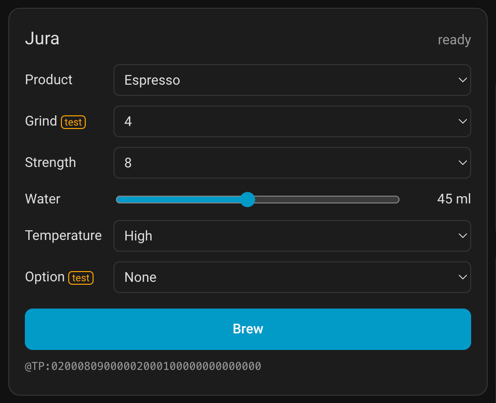
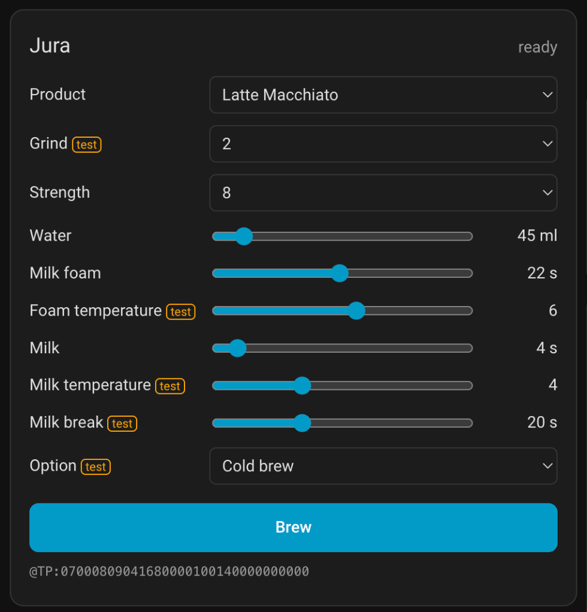
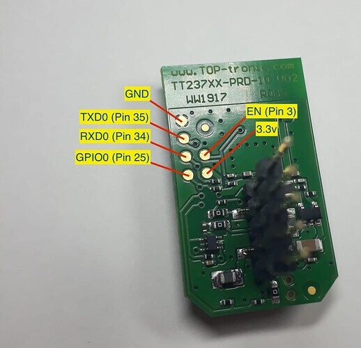

# Jura WiFi dongle → ESPHome

Reflash the original **Jura WiFi Connect** dongle with [ESPHome](https://esphome.io) and get your
Jura coffee machine into Home Assistant natively: no Jura app, no cloud, no MQTT, no extra hardware.
The dongle already has the right connector and the 5 V ↔ 3.3 V level shifting, so it only needs new firmware.

Built and tested on a **Jura Z10** (machine profile `EF545`, firmware `EF545M V02.02`) with a
TOP-tronic **TT237XX-PRD-10 V02** dongle (ESP32-WROOM-32D, original firmware TT237W V06.11).

<p>
  
  
</p>

## What you get

- **Counters:** every product, totals (coffee, milk, water), maintenance counters (cleanings,
  descalings, rinses, …) and the maintenance percentages.
- **Status:** machine status, product progress, 53 alert / info binary sensors (water tank,
  drip tray, coffee grounds, milk cleaning, …).
- **Buttons:** coffee rinse, cappu rinse / clean, cleaning, descaling, filter change, empty system,
  OK / power off, cancel.
- **Settings:** water hardness, auto off, units, language, display brightness.
- **Brewing:** any product with its own parameters, from a dashboard card or an automation.
- **No "unavailable" when the machine is off:** the dongle loses power ~5 min after the machine is
  switched off. It says goodbye to Home Assistant first, so the entities keep their last values.
- **Reversible:** back up the original firmware first and you can restore it any time.

## Contents

| Path | What it is |
|---|---|
| [`components/jura_link`](components/jura_link) | ESPHome external component: the encrypted UART protocol |
| [`jura-z10.yaml`](jura-z10.yaml) | ESPHome configuration for the Z10 with all the entities |
| [`card/jura-z10-card.js`](card/jura-z10-card.js) | Home Assistant dashboard card for brewing |
| [`profiles/`](profiles) | J.O.E. XML profiles of 75 Jura models, plus `JOE_MACHINES.TXT` |
| [`tools/pack_profiles.py`](tools/pack_profiles.py) | Packs `profiles/` into the component's `jura_profiles_blob.h` |
| [`docs/PROTOCOL-Z10.md`](docs/PROTOCOL-Z10.md) | The protocol as this firmware uses it on a Z10 |
| [`docs/HARDWARE.md`](docs/HARDWARE.md) | Dongle and service-socket wiring |
| [`docs/upstream/`](docs/upstream) | The upstream component's protocol notes and README |
| [`tests/`](tests) | Host tests for the protocol engine, the profiles and the card's recipe builder |

---

## 1. What you need

- The Jura WiFi Connect dongle, **out of the machine**.
- A **3.3 V** USB-UART adapter (CP2102, CH340, FT232, …). Never 5 V: the ESP32 is not 5 V tolerant.
- [esptool](https://docs.espressif.com/projects/esptool/) (`pip install esptool`).
- Thin wires and a soldering iron (or pogo pins) for the test pads on the back of the dongle.

### Pinout

The programming pads are on the back of the board:



*Photo: [Sebbeben/Jura-Smart-Connect-Wifi-pcb-3d-model](https://github.com/Sebbeben/Jura-Smart-Connect-Wifi-pcb-3d-model).
The rest of the circuit is in [docs/HARDWARE.md](docs/HARDWARE.md).*

| USB-UART adapter | Dongle pad |
|---|---|
| GND | GND |
| TX | RXD0 |
| RX | TXD0 |
| 3.3 V | 3.3v |
| GND, only while entering download mode | GPIO0 |
| – | EN: leave it unconnected (the board has its own reset pull-up) |

The dongle is powered only by the adapter during all of this. Do not plug it into the machine
while the adapter is connected.

### Entering download mode

1. Connect GPIO0 to GND.
2. Connect 3.3 V (power the dongle).
3. After about a second you can release GPIO0.

The adapter's DTR/RTS lines are not wired to EN/GPIO0, so esptool cannot reset the chip itself.
The esptool commands below therefore use `--before no_reset --after no_reset`, and the chip stays
in download mode between commands.
To start over, unplug and replug 3.3 V with GPIO0 held on GND.

> esptool v5 renamed the commands and options: `read-flash`, `write-flash`, `erase-flash`,
> `no-reset`. The examples use the v4 spelling. Replace `COM11` with your port
> (`/dev/ttyUSB0` on Linux).

## 2. Back up the original firmware

**Step 1: check that the chip is not locked.** This only reads the eFuses:

```
espefuse --port COM11 summary
```

Continue only if all of these hold:

| eFuse | Must be | Meaning |
|---|---|---|
| `FLASH_CRYPT_CNT` | `0` | no flash encryption |
| `ABS_DONE_0`, `ABS_DONE_1` | `False` | no secure boot |
| `UART_DOWNLOAD_DIS` | `False` | serial download works |

If any of them differs, stop: ESPHome would not boot on that dongle.

**Step 2: read the whole 4 MB flash twice:**

```
esptool --port COM11 --baud 460800 --before no_reset --after no_reset read_flash 0 0x400000 jura-orig-1.bin
esptool --port COM11 --baud 460800 --before no_reset --after no_reset read_flash 0 0x400000 jura-orig-2.bin
```

**Step 3: compare the two files.** The hashes must be identical. If they are not, a wire is loose
or the baud rate is too high: use `--baud 115200` and read again.

```
certutil -hashfile jura-orig-1.bin SHA256        # Windows
sha256sum jura-orig-1.bin jura-orig-2.bin         # Linux / macOS
```

**Keep `jura-orig-1.bin` somewhere safe and private.** It contains your WiFi password and the app
pairings. It will also differ from other people's dumps (WiFi data, RF calibration, firmware
version), which is normal.

## 3. Flash ESPHome

**Step 1: build the firmware.**

1. Copy [`jura-z10.yaml`](jura-z10.yaml) into your ESPHome config folder (in Home Assistant:
   *Settings → Add-ons → ESPHome Device Builder*).
2. Add these keys to your `secrets.yaml`: `api_key` (a 32-byte base64 key, the Device Builder
   generates one for new devices), `wifi_ssid`, `wifi_password`.
3. In the Device Builder: *jura-z10 → Install → Manual download → Factory format*.
   You get `jura-z10.factory.bin`.

**Step 2: erase and write** (dongle in download mode):

```
esptool --port COM11 --before no_reset --after no_reset erase_flash
esptool --port COM11 --baud 460800 --before no_reset --after no_reset write_flash 0x0 jura-z10.factory.bin
```

Erasing first matters: otherwise the old firmware's WiFi data stays behind in the NVS partition.

**Step 3: put it back in the machine.**

1. Disconnect the adapter.
2. Plug the dongle into the machine and switch the machine on.
3. Home Assistant discovers it (*Settings → Devices & services → ESPHome*). Add it with your `api_key`.

From now on every update goes over the air; the wires are no longer needed.

### Restore the original firmware

Download mode again, then:

```
esptool --port COM11 --baud 460800 --before no_reset --after no_reset write_flash 0 jura-orig-1.bin
```

That brings back everything as it was, including the WiFi settings and app pairings.

## 4. Optional: power-cut detection

When the machine is switched off normally, the dongle sees it coming: the machine reports
"switch-off delay" and cuts the dongle's power about 5 minutes later. After 4 minutes of that,
the firmware closes the connection to Home Assistant on purpose, so the entities stay available.

A **power cut while the machine is on** gives no warning. Without this mod the entities become
unavailable until the machine is switched on again. With it, the ESP32 measures its 5 V supply and
says goodbye to Home Assistant in the few milliseconds before it dies.

Solder a voltage divider from the dongle's 5 V to GPIO34:

```
5 V ── 9.1 kΩ ──┬── GPIO34 (pin 6 of the WROOM module)
                │
              7.5 kΩ
                │
GND ────────────┘
```

- **GPIO34 is pin 6 of the module**, counting from GND (pin 1) along the long side. It is
  not "module pin 34": that one is RXD0.
- **Keep the order:** 9.1 kΩ to 5 V and 7.5 kΩ to GND. Swapped, the pin still survives, but the
  reading is wrong.
- **Other resistor values:** change the `2.2133` factor in the YAML to `(R_top + R_bottom) / R_bottom`
  (it appears twice).
- **Without the divider**, delete the `supply_5v` sensor and the 1 ms `interval` block marked
  *Power-cut detection* from the YAML. GPIO34 would float, and a floating input can read anything.

## 5. ESPHome configuration

The component loads from this repository:

```yaml
external_components:
  - source: github://andrei-marinache/jura-wifi-dongle-esphome@main
    components: [jura_link]
```

The UART runs on GPIO17 (TX → machine) and GPIO16 (RX ← machine), 9600 8N1.

Main `jura_link` options:

| Option | Default in the example | What it does |
|---|---|---|
| `update_interval` | `60s` | How often the counters are polled |
| `auto_poll` | `true` | Poll on its own after the handshake |
| `allow_brew` | `true` | Accept the `brew` action; `false` refuses every brew |
| `response_timeout` | `3s` | Wait per command before retrying |
| `settings` | `["02", "13", "08", "09", "0A"]` | Machine settings to read: hardness, auto off, units, language, brightness |
| `machine_type`, `last_error` | – | Optional text sensors |

**Machine profiles.** [`jura_profiles_blob.h`](components/jura_link/jura_profiles_blob.h) holds the
profiles of 75 Jura models in 113 KB of flash.

- **Contents per model:** products and their brew parameters, maintenance labels, alert bits.
- **Origin:** packed from the XML files in [`profiles/`](profiles) by
  [`tools/pack_profiles.py`](tools/pack_profiles.py), so the ESP32 needs no XML parser. To rebuild it
  after changing a profile:

  ```
  python3 tools/pack_profiles.py --xml-dir profiles/xml --machines profiles/JOE_MACHINES.TXT \
      --header components/jura_link/jura_profiles_blob.h
  ```

  Run on the files as shipped, this reproduces the current blob byte for byte.
- **Use:** at the handshake the machine reports its code (the Z10 sends `EF545`) and the firmware
  picks that profile. It tells the firmware which counters to poll, the product names, and which
  product codes the `brew` action accepts.
- **Limit:** the packer drops grind, milk temperature, stroke and the preselections, which is why the
  card reads the full XML itself.

**Other Jura models.** The component finds the right profile on its own. The example YAML, however,
is written for the Z10:

- alert bit names
- product codes in the totals
- setting values
- language codes: measured on one Z10; a regional variant may have other languages on the same codes

For another model, adapt these from that model's profile in `profiles/xml/<EF code>/`. Expect to debug.

**Coming from AlexxIT's Bluetooth integration?** The device is named `Jura` and the entity names,
units and state classes match that integration. Remove the old Bluetooth device first, and the new
entities take over the same entity ids and their history.

## 6. Brew card

### Install

1. Copy [`card/jura-z10-card.js`](card/jura-z10-card.js) to `/config/www/jura-z10-card.js`.
2. Copy [`profiles/xml/EF545/1.4.xml`](profiles/xml/EF545/1.4.xml) to `/config/www/jura/EF545.xml`.
   On another model, copy its own profile and set the card's `profile:` option to it.
3. *Settings → Dashboards → ⋮ → Resources → Add resource*:
   - URL `/local/jura-z10-card.js?v=1`
   - type *JavaScript module*
   - When you update the file later, raise `?v=` so browsers fetch the new one.
4. Edit a dashboard → *Add card → Manual*:

   ```yaml
   type: custom:jura-z10-card
   ```

5. Reload the page (Ctrl+Shift+R).

### How it works

- Pick a product, and only that product's parameters show up, set to its factory values.
- *Option* offers the preselections that product supports: Double, Extra shot, Cold brew, Ground coffee.
- *Brew* sends one `@TP:` recipe to the dongle. The line under the button shows exactly what will be sent; tap it to copy the recipe.

Parameters marked **test** are not confirmed on a real machine yet:

| Parameter | Status |
|---|---|
| Strength, Water, Milk, Milk foam, Temperature | brewed on a Z10 ([jura-connect](https://github.com/makefu/jura-connect)) |
| Bypass, Milk break | always sent with the factory value, like the J.O.E. app; not confirmed on a Z10 |
| Grind, Foam / Milk temperature, Stroke | **test**: encoding is a guess; sent only if you change them |
| Double, Extra shot, Cold brew, Ground coffee | **test**: encoding from the J.O.E. app, never seen on the wire |

Left untouched, the recipe is exactly what the firmware's own encoder produces. Every test
parameter you change is a real experiment, and a wrong byte can give a wrong drink.

### Options

| Option | Default |
|---|---|
| `title` | `Jura` |
| `profile` | `/local/jura/EF545.xml` |
| `action` | `esphome.jura_z10_brew` |
| `status` | `sensor.jura_status` |
| `connection` | `binary_sensor.jura_connection` |

### Brewing from an automation

The card only builds the recipe. Anything can send one:

```yaml
action: esphome.jura_z10_brew
data:
  recipe: "02000809000002000100000000000000"   # Espresso, factory values
```

The recipe is 16 bytes as 32 hex characters:

| Byte | Content |
|---|---|
| 0 | product code |
| `n-1` | parameter `Fn` from the XML |
| 8 | always `01` |
| any other | `00` = not set, the machine keeps its own value |

The easiest way to get a recipe is to set it up in the card and copy the `@TP:` line.

## 7. How it talks to the machine

In short:

- **Line:** 9600 8N1, each byte spread over 4 UART bytes, and a nibble cipher on top.
- **Session:** a handshake (`@T1` → `@T2` → `@T3`). The Z10 also needs `@TR:37` right after the
  handshake, or it drops the session two seconds later.
- **Messages:**
  - The machine pushes status (`@TF`) and progress (`@TV`) on its own.
  - Counters (`@TR:32`, `@TG:43`, `@TG:C0`) and settings (`@TM`) are polled.
  - A request that collides with a push is sent again.

Details:
- [`docs/PROTOCOL-Z10.md`](docs/PROTOCOL-Z10.md): everything this firmware sends and expects on a Z10.
- [`docs/upstream/AT-PROTOCOL.md`](docs/upstream/AT-PROTOCOL.md): the frame format and the cipher.
- [makefu/jura-connect `docs/PROTOCOL.md`](https://github.com/makefu/jura-connect/blob/main/docs/PROTOCOL.md):
  the most complete description, covering many more machines.

## Tests

From the repository root:

```
g++ -std=c++17 -Wall -Wextra -Werror -Icomponents tests/reply_match_test.cpp -o /tmp/reply-match && /tmp/reply-match
g++ -std=c++17 -Wall -Wextra tests/jura_protocol_test.cpp -o /tmp/protocol && /tmp/protocol
g++ -std=c++17 -Wall -Wextra tests/jura_jprf_test.cpp -o /tmp/jprf && /tmp/jprf
node tests/recipe_test.js
```

## Credits

This project stands on other people's work:

- [harryzz/jura-uart-esphome](https://github.com/harryzz/jura-uart-esphome) (MIT): the original ESPHome
  component.
  - What came from it: the cipher, the handshake, the packed machine profiles,
    [`tools/pack_profiles.py`](tools/pack_profiles.py), two of the [tests](tests) and the notes in
    [`docs/upstream/`](docs/upstream).
  - [`components/jura_link`](components/jura_link) is a patched copy of commit `23c76ff`.
  - Patches: `@TR:37` session keep-alive, strict reply matching with retries, re-handshake, machine
    settings, maintenance percentage N/A handling, the brew action.
- [makefu/jura-connect](https://github.com/makefu/jura-connect): the protocol documentation, the
  `@TP:` recipe format, and the recipe bytes verified on a Z10.
- [makefu/jura-connect-hass](https://github.com/makefu/jura-connect-hass) (MIT): its brew card was the
  starting point for this one.
- [AlexxIT/Jura](https://github.com/AlexxIT/Jura) (MIT): the Bluetooth integration whose entity names
  this firmware keeps. [`profiles/`](profiles) is the content of its `resources.zip`.
- [Sebbeben/Jura-Smart-Connect-Wifi-pcb-3d-model](https://github.com/Sebbeben/Jura-Smart-Connect-Wifi-pcb-3d-model):
  photos, pinout, KiCad schematic and PCB of the dongle, a 3D-printable case, and a dump of the
  original firmware. The pinout photo above is from that repository, and
  [`docs/HARDWARE.md`](docs/HARDWARE.md) describes the circuit from its schematic.
- [Jutta-Proto](https://github.com/Jutta-Proto) (GPL-3.0): the service-socket pinout and early
  research on the UART line encoding. No code is copied from it.

## Disclaimer

Not affiliated with Jura or TOP-tronic. Flashing the dongle replaces its firmware, and the Jura app
will no longer connect to it until you restore the backup. Brewing parameters marked *test* are
experiments. Use at your own risk.

## License

MIT, see [LICENSE](LICENSE). Third-party parts keep their own terms:

- [`components/jura_link`](components/jura_link): MIT, harryzz.
- [`tools/pack_profiles.py`](tools/pack_profiles.py), [`docs/upstream/`](docs/upstream),
  `tests/jura_protocol_test.cpp`, `tests/jura_jprf_test.cpp`: MIT, harryzz.
- [`profiles/`](profiles): Jura's machine profiles, as redistributed by AlexxIT/Jura (MIT).
- [`docs/img/dongle-pinout.jpeg`](docs/img/dongle-pinout.jpeg): Sebbeben, used with credit.
